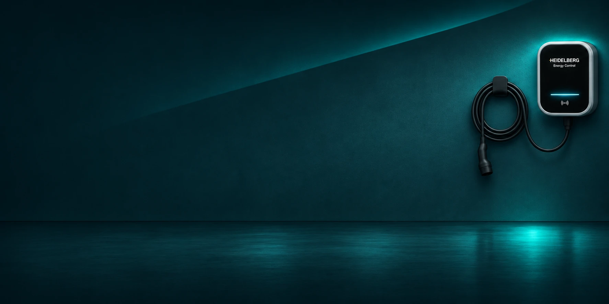
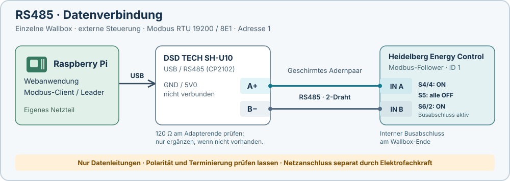

# Wallbox Control for Raspberry Pi

[English](README.md) | **Deutsch**

Lokale Wallbox-Steuerung und -Überwachung auf dem Raspberry Pi mit Flask,
Modbus RTU und SQLite. Enthält Live-Messwerte, Ladeplanung, Ladeautomatik,
personenbezogene Ladehistorie, Stromtarife und optionale Fahrzeugbilder.

**Verwendete Wallbox:** Das Projekt wurde mit einer **Heidelberg Wallbox
Energy Control (11 kW, Amperfied)** umgesetzt. Die Kommunikation erfolgt
über Modbus RTU mit einem **DSD TECH SH-U10 USB-zu-RS485-Konverter** am
Raspberry Pi. Die Software ist für eine einzelne Energy Control ausgelegt;
eine Kompatibilität mit anderen Modellen oder ein Mehr-Wallbox-Lastmanagement
wird nicht zugesichert. Dies ist ein unabhängiges Projekt, keine offizielle
Herstellersoftware.

## Ein erster Eindruck


*Animierte Vorschau der Ladeanzeige: Das GIF verwendet das originale
Demo-Fahrzeugmotiv, die SVG-Konturen der Wallbox und die Kabelanimation
aus der Anwendung. Es ist ein separat gerenderter Ausschnitt, keine
Browser-Bildschirmaufnahme.*

Während eines virtuellen Ladevorgangs zeigt das Dashboard beispielsweise
eine Ladeleistung von **11,0 kW**, den Fahrzeugstatus „Verbunden“, den
Wallbox-Status „Lädt“ und die zugeordnete Demo-Person an.

## Demo ausprobieren (keine Wallbox erforderlich)

Der Demo-Modus erzeugt beim ersten Start automatisch die fiktive Person
**Alex Beispiel (Demo)**, ihr bereitgestelltes Fahrzeugbild und drei Monate
mit Beispiel-Ladevorgängen. Der Verbrauch, die Dauer, die Zählerstände und
Stromkosten der einzelnen Sitzungen sind aufeinander abgestimmt. Die
Historie wird nur einmal erzeugt und bei einem erneuten Start nicht verdoppelt.

```bash
python3 -m venv .venv
source .venv/bin/activate
python -m pip install -r requirements.txt
python wallbox_monitor.py --demo
```

Im Browser: http://127.0.0.1:5000.

Der deutlich gekennzeichnete Demo-Modus nutzt eine virtuelle Wallbox.
Über **Fahrzeug trennen / anschließen** oben im Dashboard lassen sich das
neutrale Wallbox-Motiv und das Demo-Fahrzeugbild wechseln.

| Fahrzeug angeschlossen | Kein Fahrzeug angeschlossen |
| :---: | :---: |
|  |  |

*Die beiden Originalmotive werden direkt im Dashboard verwendet.*

Auch Ladestart, Leistungsstufen und Ladestopp können simuliert werden.
Alle Änderungen und zusätzlichen Personen im Demo-Modus bleiben in `demo/data/`; es gibt
keine Verbindung zu einer echten Wallbox und keine Vermischung mit echten
Ladedaten.

### Demo unter Windows (PowerShell)

Python 3.13 wird empfohlen; für Python 3.15 wird das dazu passende PyYAML 6.0.4 ausgewählt. In einem entpackten Projektordner mit zugelassener Python-Installation:

```powershell
python -m pip install --only-binary=:all: -r requirements.txt
python wallbox_monitor.py --demo
```

Die Installation verwendet ausschließlich vorkompilierte Pakete (Wheels).
Das Paket `tzdata` stellt auch unter Windows die Zeitzone Europe/Berlin bereit.
Falls die Sicherheitsrichtlinien des Rechners die Installation oder das Laden
eines Pakets blockieren, ist eine Freigabe durch den zuständigen Administrator erforderlich.

## Hardwareaufbau: Heidelberg Energy Control

Für den beschriebenen Einzel-Wallbox-Aufbau übernimmt der Raspberry Pi die
Modbus-Client-Rolle (Leader); die Wallbox antwortet als Server (Follower).
Die Webanwendung läuft auf dem Pi. Die noch nicht angeschlossene Hardware
kann im Demo-Modus vollständig simuliert werden.

> [!WARNING]
> **Arbeiten in der Wallbox ausschließlich durch eine Elektrofachkraft.**
> Im Gehäuse befinden sich lebensgefährliche Netzspannungen. Vor dem Öffnen,
> Anschließen oder Ändern von Schaltern muss die Fachkraft die Anlage nach
> den geltenden Sicherheitsregeln freischalten und Spannungsfreiheit feststellen.
> Diese Übersicht ist kein Netzanschlussplan und ersetzt nicht die zum
> konkreten Gerät passende Montage- und Lastmanagementanleitung.
> Vorhandene Schutz-, Freigabe- und Netzbetreibereinrichtungen dürfen nicht
> überbrückt oder außer Betrieb gesetzt werden.

### Benötigte Komponenten

| Komponente | Aufgabe |
| --- | --- |
| Raspberry Pi mit USB-Port, Raspberry Pi OS und eigenem Netzteil | Webserver, Datenbank und Modbus-Client |
| DSD TECH SH-U10 USB-zu-RS485-Konverter (CP2102) | USB-Verbindung zum RS485-Bus |
| Heidelberg Wallbox Energy Control, fachgerecht installiert | Typ-2-Ladestation mit RS485-Schnittstelle |
| Geschirmte, verdrillte Busleitung (z. B. CAT6a) | Zwei Signaladern für RS485 |
| 120-Ω-Busabschluss am Adapterende, falls nicht bereits vorhanden | Terminierung des ersten Busteilnehmers |

Das konkrete Raspberry-Pi-Modell spielt für diese Dokumentation keine Rolle,
sofern Python und die USB-Schnittstelle unterstützt werden.

### RS485-Verbindung



Der Adapter wird per USB mit dem Pi verbunden. Für die einzelne Wallbox dient
das Klemmenpaar **IN A / IN B** als Bus-Eingang (siehe Abbildung VIII in [1]).
Die Zuordnung nach Klemmenbeschriftung lautet:

| SH-U10 | Heidelberg Energy Control | Signal |
| --- | --- | --- |
| A+ | IN A | erste RS485-Datenader |
| B− | IN B | zweite RS485-Datenader |
| GND, GND | nicht anschließen | kein Masseanschluss im beschriebenen 2-Draht-Aufbau |
| 5V0 | nicht anschließen | 5-V-Ausgang des Adapters, **keine** Wallbox-Versorgung |

Die Fachkraft muss die Signalpolarität anhand der konkreten Geräteversion
bestätigen: A/B-Bezeichnungen sind bei RS485 nicht herstellerübergreifend
eindeutig. Bei ausbleibender Kommunikation die Polarität kontrollieren.
Den Schirm an der vorgesehenen Schirmauflage der Wallbox nach [1] befestigen,
nicht mit GND oder einer Signalader verwechseln. Datenleitung und
Netzspannungsleitung getrennt führen. Der Pi und die Wallbox haben jeweils
ihre eigene Stromversorgung. Eine geeignete galvanische Trennung und
Potentialverhältnisse sind von der Fachkraft zu beurteilen; die
ESD-Schutzangabe des SH-U10 allein belegt keine galvanische Trennung.

Am Ende der Leitung in der Wallbox wird der interne Abschluss über S6/2
aktiviert. Am anderen Ende muss ein 120-Ω-Abschluss am USB-Adapter vorhanden
sein. Ob die verwendete SH-U10-Ausführung schon einen Abschluss enthält,
ist anhand der Adapterunterlagen oder durch fachkundige Prüfung festzustellen.
Nur bei fehlendem Abschluss einen passenden externen Widerstand zwischen
A und B vorsehen; nicht doppelt terminieren. Der Aufbau setzt genau einen
Modbus-Leader auf diesem Bus voraus. [1][2]

### DIP- und Drehschalter: externe Steuerung, Bus-ID 1

Die nachfolgende **Referenzkonfiguration** gilt für eine einzelne Energy
Control in der Betriebsart externes Lastmanagement gemäß [1], Kapitel 4
(Abb. XIV). Sie passt zu der im Programm eingestellten Adresse `UNIT_ID = 1`.
Die Schalter sind nach der tatsächlichen Nummerierung und ON-Markierung
der Platine zu identifizieren, nicht nach der Orientierung eines Fotos.

| DIP-Gruppe | 1 | 2 | 3 | 4 | Bedeutung |
| --- | :---: | :---: | :---: | :---: | --- |
| S2 | OFF | OFF | OFF | OFF | keine Sonderadressierung für Bus-ID 16 |
| S4 | OFF | OFF | OFF | **ON** | Modbus-Adresse 1 |
| S5 | OFF | OFF | OFF | OFF | Follower, externe Steuerung durch den Pi |
| S6 | OFF | **ON** | OFF | OFF | interne Busterminierung an der letzten Wallbox |

Die Drehschalter S1 und S3 bestimmen Stromgrenzen, nicht die Modbus-Adresse:

| Drehschalter | Stellung im 11-kW-Beispiel | Bedeutung |
| --- | --- | --- |
| S1 | 5 (auch 6–9 entsprechen 16 A) | maximal 16 A je Phase **nur**, wenn das für Installation und Wallbox freigegeben ist |
| S3 | 0 | minimal 6 A |

**S1 ist kein allgemeingültiger Einstellwert.** Die Elektrofachkraft legt den
zulässigen maximalen Ladestrom entsprechend der installierten Anlage fest.
Eine bereits niedriger konfigurierte Stromgrenze darf nicht wegen dieser
Anleitung erhöht werden. Das Programm fordert im Standard bis zu 16 A an;
vor einem Echtbetrieb muss dessen Konfiguration mit den vorgegebenen
Stromgrenzen abgeglichen werden. Die Software ersetzt keine elektrische
Absicherung, kein vorgeschriebenes Lastmanagement und keine Schutzeinrichtung.

### Modbus-Parameter im Programm

Die Einstellungen in [`wallbox_monitor.py`](wallbox_monitor.py) entsprechen
der Energy-Control-Schnittstelle laut [1], Kapitel 5:

| Parameter | Einstellung |
| --- | --- |
| Schnittstelle | `/dev/ttyUSB0` (Linux; ggf. tatsächlichen Port anpassen) |
| Protokoll | Modbus RTU, RS485, 2-Draht, Halbduplex |
| Baudrate | 19200 bit/s |
| Datenbits | 8 |
| Parität | Even (E, gerade) |
| Stoppbits | 1 |
| Bus-ID | 1 |
| Leseintervall | 2 s |
| Timeout pro Modbus-Anfrage | 1 s |
| Lesefunktion | 04 (Input Register) |
| Schreibfunktion | 06 (Holding Register) |
| Registeradressierung | unverändert, kein Offset −1 |

Die Messwerte werden aus den Input-Registern gelesen (u. a. Register 5
für den Ladezustand). Über Holding-Register 261 wird der Strom in
0,1-A-Schritten vorgegeben: `0` sperrt die Ladung, `160` fordert 16 A an.
Laut Registerbeschreibung [3] ist Register 261 ab Registerlayout-Version
1.0.7 verfügbar und erlaubt 0 oder 60 bis 160. Die tatsächliche Leistung
hängt auch von der Zahl der Phasen, der Netzspannung, dem Fahrzeug und der
installierten Stromgrenze ab.

> [!NOTE]
> Die derzeitige 2-kW-Stufe im Programm sendet den Wert 30 (3 A).
> Dieser Wert liegt unter dem dokumentierten Bereich und wird von der
> Energy Control laut [3] als keine Ladefreigabe interpretiert. Der
> Demo-Modus simuliert diese Stufe; im Echtbetrieb ist sie nicht als
> unterstützte 2-kW-Ladeleistung anzusehen. Die zulässigen Stromvorgaben
> und das Verhalten bei Kommunikationsverlust sind vor Echtbetrieb
> fachkundig zu verifizieren (Register 257, 258 und 262 in [3]).

### Raspberry Pi vorbereiten und Kommunikation prüfen

1. Nach Abschluss der fachgerechten Installation den SH-U10 am Pi
   anschließen und die in Linux erkannte Schnittstelle prüfen:

   ```bash
   ls -l /dev/ttyUSB*
   ls -l /dev/serial/by-id/
   ```

   Der Gerätename kann sich ändern. Falls vorhanden, kann der stabile
   Pfad unter `/dev/serial/by-id/` als `PORT` in
   `wallbox_monitor.py` verwendet werden.
2. Falls der Benutzer keinen Zugriff auf die serielle Schnittstelle hat,
   die Dateiberechtigungen prüfen. Unter Raspberry Pi OS erfolgt der
   Zugriff gewöhnlich über die Gruppe `dialout`:

   ```bash
   sudo usermod -aG dialout "$USER"
   ```

   Danach ab- und wieder anmelden. Bei abweichenden Gruppen die lokale
   Systemkonfiguration beachten; die Anwendung nicht als root starten.
3. Die Elektrofachkraft nimmt den Aufbau nach [1], Kapitel 6, ohne
   angeschlossenes Fahrzeug in Betrieb. Die externe Steuerung zuerst
   starten; nach dem Einschalten der Wallbox mindestens zehn Sekunden
   für deren Initialisierung einplanen.
4. Nach Installation der Software (siehe unten) `python wallbox_monitor.py`
   starten und das Dashboard öffnen. Erst gültige Live-Messwerte und der
   Online-Status bestätigen eine Antwort der Wallbox; das bloße Öffnen
   von `/dev/ttyUSB0` ist noch kein Kommunikationstest.
5. Vor der ersten Ladefreigabe die eingestellten Stromgrenzen, die
   Abschaltung und das Verhalten bei Kommunikationsverlust fachkundig
   prüfen. Die Automatik erst danach aktivieren.

### Wenn keine Modbus-Antwort kommt

- USB-Port und Zugriff prüfen; sicherstellen, dass kein anderer Dienst den
  seriellen Port verwendet.
- Adresse 1, S4/S5, 19200/8E1 sowie die Signalpolarität und Terminierung
  prüfen lassen.
- Die Energy Control ist im Standby unter Umständen nicht per Modbus
  erreichbar. Die Standby-/Watchdog-Einstellungen sind abhängig von der
  Registerlayout-Version; keine undokumentierten Werte schreiben.
- Bei der LED-Folge mit sechs kurzen weißen und drei langen blauen Impulsen
  meldet die Wallbox einen Kommunikationsfehler laut [1]. Bei anhaltender
  Störung die Herstelleranleitung bzw. den Installateur heranziehen.

### Herstellerunterlagen

- [1] [Amperfied: Energy Control – Lastmanagement (Installation, Schalter, RS485, Kapitel 2–6)](https://www.amperfied.de/wp-content/uploads/2022/08/2022_05_Lastmanagement.pdf)
- [2] [DSD TECH: SH-U10 – Produkt- und Anschlussinformationen](https://www.deshide.com/product-details_SH-U10.html)
- [3] [Amperfied: ModBus Register Layout – Energy Control, Ausgabe 2022-08-09](https://www.amperfied.de/wp-content/uploads/2023/03/20220809_AMP-Erweiterte-ModBus-Registerbeschreibung.pdf)
- [Amperfied: aktuelle Registerbeschreibungen und Herstellerunterlagen](https://www.amperfied.de/support/wissensdatenbank/energy-control-plus/)
- [Amperfied: Betriebsanleitung Energy Control / Home Eco](https://www.amperfied.de/wp-content/uploads/2022/06/2022_05_Betriebsanleitung_deutsch-3.pdf)

Die Angaben sind auf die hier beschriebene Energy Control und die genannten
Unterlagen bezogen. Vor Arbeiten immer die Anleitung der vorhandenen
Geräte-/Platinenrevision heranziehen.

## Installation und Start im Echtbetrieb

In einem neuen Projektordner (nicht über eine produktive Installation mit
bestehenden Daten kopieren):

```bash
python3 -m venv .venv
source .venv/bin/activate
python -m pip install -r requirements.txt
python wallbox_monitor.py
```

Im Browser auf dem Raspberry Pi: http://127.0.0.1:5000.

Für andere Bind-Adressen bzw. Ports können `WALLBOX_HOST` und `WALLBOX_PORT`
gesetzt werden. Das Programm liest standardmäßig am seriellen
Anschluss `/dev/ttyUSB0`. Vor Hardwarebetrieb alle Modbus-Einstellungen
und Stromgrenzen in `wallbox_monitor.py` anhand der Dokumentation des eigenen
Wallbox-Modells prüfen.

## Sprache umschalten

In **Einstellungen** befindet sich oben eine kompakte Sprachwahl für
Deutsch (DE), English (EN), Français (FR) und Español (ES). Die bevorzugte
Sprache wird im jeweiligen Browser gespeichert. Navigation, Dialoge,
Statusmeldungen, Ladehistorie, Datums- und Zahlenformate werden lokalisiert.
Die Auswahl lädt die Oberfläche kurz neu und öffnet den aktuellen
Einstellungsbereich wieder; nicht gespeicherte Formulareingaben sollten daher
vorher gespeichert werden. Wallbox-Daten, Tarife und die Zeitzone bleiben
unverändert. Native Browser-Dialoge folgen der Sprache des Browsers.

## Automatischer Ladestart

Unter **Einstellungen → Automatik** die tägliche Ladezeit (deutsche Ortszeit)
und eine Standardperson auswählen, die Automatik aktivieren und speichern.
Zur eingestellten Uhrzeit startet die Ladung nur, wenn ein Fahrzeug
angeschlossen ist, die Wallbox eine Freigabe zulässt und keine andere Ladung
aktiv oder geplant ist. Wird das Fahrzeug erst später angeschlossen, erfolgt
kein nachträglicher automatischer Ladestart.

Auf der Startseite ist der nächste Termin auch ohne angeschlossenes Fahrzeug
sichtbar. **Diesen Ladestart überspringen** lässt nur diesen einen Termin
ausfallen. Mit **Überspringen rückgängig machen** kann der Termin bis zur
Startzeit wieder aktiviert werden. Die tägliche Automatik bleibt dabei aktiv.
Die Ausnahme bleibt auch nach einem Neustart erhalten. Änderungen an
Startzeit, Standardperson oder Aktivierung setzen eine ausstehende Ausnahme
zurück. Ein bereits ausgeführter oder in älteren Versionen als erledigt
gespeicherter Termin wird nicht nachträglich erneut gestartet.

## Personen hinzufügen

1. **Einstellungen → Personen & Bilder** öffnen.
2. **+ Person hinzufügen** wählen, Namen eingeben und bestätigen.
3. Bei Bedarf ein eigenes Fahrzeugbild auswählen und speichern.
4. Die neue Person steht sowohl beim manuellen Ladestart als auch in den
   Automatik-Einstellungen zur Auswahl.

### Personen löschen

In **Einstellungen → Personen & Bilder** besitzt jede Person einen separaten
Button **Person löschen**. Nach Bestätigung werden das Profil und das zugehörige
Fahrzeugbild dauerhaft entfernt. Bereits abgeschlossene Ladevorgänge bleiben
einschließlich der damaligen Namen, Verbräuche und Kosten unverändert.
Laufende, freigegebene, geplante oder noch offene Ladevorgänge der Person
müssen zuvor beendet bzw. abgebrochen werden. War sie als Standardperson
eingestellt, wird die Ladeautomatik deaktiviert und die Zuordnung entfernt.
Die fiktive Demo-Person wird nach dem Löschen nicht automatisch erneut angelegt.

Namen müssen eindeutig sein. Neue Personen werden in `persons.yaml` gespeichert;
die Datei wird bei der ersten Anlage automatisch erzeugt.

## Lokale Daten

Diese Version enthält keine privaten Personen, Fahrzeugbilder oder historischen
Ladevorgänge des ursprünglichen Projekts. Mitgeliefert werden das neutrale
Wallbox-Motiv (`static/wallbox-idle.webp`) und das Demo-Fahrzeugmotiv mit
dem fiktiven Kennzeichen (`demo/demo-vehicle.webp`).
Der Echtbetrieb startet ohne Beispieldaten. Eine neue Datenbank wird beim
Start angelegt, wenn keine Datenbank vorhanden ist.

Die folgenden Dateien bleiben lokal und sind in `.gitignore` ausgeschlossen:

- `persons.yaml`: Personen mit automatisch erzeugten IDs
- `person_images/`: hochgeladene Fahrzeugbilder
- `wallbox_sessions.db`: Ladevorgänge, Tarife, Planung und Automatik
- `.venv/`: lokal installierte Python-Abhängigkeiten
- `demo/data/`: alle generierten und später hinzugefügten Demo-Daten

Die Bereinigung gilt für dieses Paket, nicht für bereits bestehende
Installationen oder Sicherungen.

## Projektstruktur

```text
wallbox-control-rpi/
├── wallbox_monitor.py      # Anwendung und echte Wallbox-Steuerung
├── requirements.txt        # Python-Abhängigkeiten
├── README.md              # Englische Hauptdokumentation
├── README.de.md           # Deutsche Dokumentation
├── .gitignore
├── static/                 # Gemeinsame Oberfläche, leeres Wallbox-Motiv
├── templates/              # HTML-Dashboard
├── docs/
│   ├── charging-demo.gif    # Demo-Ladeanimation
│   ├── hardware-setup.svg    # Anschlussdiagramm (Englisch)
│   └── hardware-setup-de.svg # Anschlussdiagramm (Deutsch)
├── demo/
│   ├── __init__.py          # Simulator und Erzeugung fiktiver Daten
│   └── demo-vehicle.webp    # Fiktives Fahrzeugmotiv
└── tests/                  # Automatisierte Regressionstests
```

Der Ordner `demo/data/` entsteht erst beim Demo-Start und bleibt außerhalb
der Versionsverwaltung. Bestehende Daten des alten Ordners `demo_data/`
werden beim nächsten Demo-Start übernommen, sofern `demo/data/` noch nicht
existiert. Sind beide Ordner vorhanden, bleiben beide unverändert.
Der Echtbetrieb lädt keine Demo-Module und funktioniert auch ohne `demo/`.

## Tests ohne Wallbox

```bash
python -m unittest discover -s tests -v
```

Die Tests verwenden unabhängige temporäre Daten und simulierte Hardwarebefehle.
Sie prüfen auch die einmalige Erzeugung, die Bildzuordnung und die vollständige
Trennung von Demo und Echtbetrieb. Optional mit installiertem Node.js lassen
sich die Übersetzungs- und Sprachwechsel-Tests ausführen:

```bash
node tests/test_i18n.js
```

## Sicherheit und Status

Experimentelle Software. Die Weboberfläche verfügt noch über keinen
Anmelde- oder CSRF-Schutz. Zugriff nur lokal bzw. in einem geeigneten
vertrauenswürdigen Netz; keine direkte Veröffentlichung des Webservers im
Internet. Der ursprüngliche Aufbau verwendet die Heidelberg Energy Control;
die hier dokumentierte Veröffentlichung wird softwareseitig im Demo-Modus
getestet. Der Echtbetrieb muss am konkreten Gerät fachkundig geprüft werden. Eine Open-Source-Lizenz wurde noch
nicht festgelegt.
