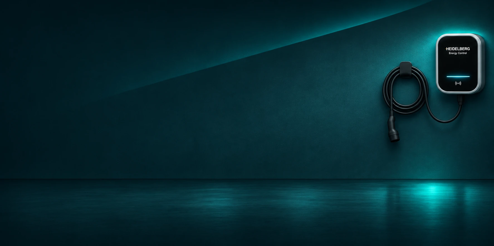
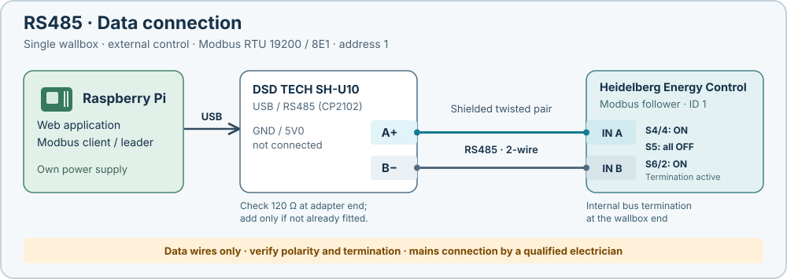

# Wallbox Control for Raspberry Pi

**English** | [Deutsch](README.de.md)

Local wallbox control and monitoring on a Raspberry Pi using Flask,
Modbus RTU and SQLite. The project provides live measurements, scheduled
and automatic charging, per-person charging history, electricity rates,
and optional vehicle images.

**Hardware used:** This project was developed with a **Heidelberg Wallbox
Energy Control (11 kW, Amperfied)**. Communication uses Modbus RTU via a
**DSD TECH SH-U10 USB-to-RS485 converter** connected to the Raspberry Pi.
The software is designed for one Energy Control wallbox. Compatibility with
other models or multi-wallbox load management is not guaranteed. This is
an independent project, not official manufacturer software.

## A first look


*Animated preview of the charging display: the GIF uses the original demo
vehicle image, the wallbox SVG outlines and the application's charging
cable animation. This is a separately rendered excerpt, not a browser
screen recording.*

During a simulated charging session, the dashboard can show a charging
power of **11.0 kW**, the vehicle status “Connected”, the wallbox status
“Charging”, and the assigned demo person.

## Try the demo (no wallbox required)

On the first launch, the demo automatically creates the fictional person
**Alex Beispiel (Demo)**, their example vehicle image and three months of
sample charging sessions. Consumption, duration, meter readings and
electricity costs are consistent with one another. The history is generated
only once and is not duplicated on subsequent starts.

```bash
python3 -m venv .venv
source .venv/bin/activate
python -m pip install -r requirements.txt
python wallbox_monitor.py --demo
```

Open http://127.0.0.1:5000 in your browser.

The interface defaults to German. Select English under **Settings →
Language** (*Einstellungen → Sprache*) if needed.

The clearly marked demo mode uses a virtual wallbox. The **Disconnect
vehicle / Connect vehicle** button at the top of the dashboard switches
between the neutral wallbox image and the demo vehicle image.

| Vehicle connected | No vehicle connected |
| :---: | :---: |
|  |  |

*Both original images are used directly in the dashboard.*

Starting and stopping a charging session and adjusting the power level
can also be simulated. All demo changes and additional people are stored
in `demo/data/`. No real wallbox is connected, and the demo never mixes
its data with actual charging records.

### Demo on Windows (PowerShell)

Python 3.13 is recommended. Python 3.15 uses the matching PyYAML 6.0.4
dependency. In an extracted project folder with an approved Python installation:

```powershell
python -m pip install --only-binary=:all: -r requirements.txt
python wallbox_monitor.py --demo
```

This installation uses only prebuilt packages (wheels). The `tzdata`
package also supplies the Europe/Berlin time zone on Windows. If computer
security policies block package installation or loading, authorization
from the responsible system administrator is required.

## Hardware setup: Heidelberg Energy Control

In this single-wallbox setup, the Raspberry Pi acts as the Modbus client
(leader), and the wallbox responds as the server (follower). The web
application runs on the Pi. Demo mode can simulate the entire setup without
a physical wallbox.

> [!WARNING]
> **Work inside the wallbox must be performed only by a qualified electrician.**
> The enclosure contains potentially lethal mains voltages. Before opening
> the enclosure, making connections or changing switches, the electrician
> must isolate the installation and verify that it is de-energized in
> accordance with applicable safety procedures. This overview is not a mains
> wiring diagram and does not replace the installation and load management
> instructions for the specific device. Do not bypass or disable existing
> protective devices, authorization interfaces or grid operator controls.

### Required components

| Component | Purpose |
| --- | --- |
| Raspberry Pi with USB port, Raspberry Pi OS and its own power supply | Web server, database and Modbus client |
| DSD TECH SH-U10 USB-to-RS485 converter (CP2102) | Connects USB to the RS485 bus |
| Professionally installed Heidelberg Wallbox Energy Control | Type 2 charging station with RS485 interface |
| Shielded twisted-pair bus cable (e.g. CAT6a) | Two RS485 signal conductors |
| 120 Ω bus termination at the adapter end, if not already fitted | Termination at the first bus participant |

The specific Raspberry Pi model is not prescribed, provided it supports
Python and the USB interface.

### RS485 connection



Connect the adapter to the Pi using USB. For a single wallbox, the
**IN A / IN B** terminals are the bus input (see Figure VIII in [1]).
The nominal mapping according to the terminal labels is:

| SH-U10 | Heidelberg Energy Control | Signal |
| --- | --- | --- |
| A+ | IN A | First RS485 data conductor |
| B− | IN B | Second RS485 data conductor |
| GND, GND | Do not connect | No ground connection in this two-wire setup |
| 5V0 | Do not connect | Adapter's 5 V output, **not** the wallbox power supply |

A qualified electrician must confirm the signal polarity for the specific
device revisions: RS485 A/B naming is not consistent across manufacturers.
If there is no communication, have the polarity checked. Attach the cable
shield to the wallbox's designated shield connection as specified in [1];
do not confuse it with GND or either signal conductor. Route the data cable
separately from mains wiring. The Pi and the wallbox each have their own
power supply. Appropriate galvanic isolation and potential differences
must be assessed by a qualified electrician; the SH-U10's ESD protection
rating alone is not evidence of galvanic isolation.

At the wallbox end of the cable, enable its internal bus termination with
S6/2. The USB adapter end must have a 120 Ω termination as well. Check the
adapter documentation or have the specific SH-U10 revision examined to
determine whether termination is already fitted. Add an appropriate
external resistor between A and B only if it is missing. Do not terminate
the same bus end twice. This setup requires exactly one Modbus leader on
the bus. [1][2]

### DIP and rotary switches: external control, bus ID 1

The following **reference configuration** is for one Energy Control in
external load management mode, as described in [1], Chapter 4 (Figure XIV).
It matches the application's configured address, `UNIT_ID = 1`.
Identify the switch numbers and ON marking on the actual circuit board;
do not rely on the orientation of a photograph.

| DIP switch block | 1 | 2 | 3 | 4 | Purpose |
| --- | :---: | :---: | :---: | :---: | --- |
| S2 | OFF | OFF | OFF | OFF | No special addressing for bus ID 16 |
| S4 | OFF | OFF | OFF | **ON** | Modbus address 1 |
| S5 | OFF | OFF | OFF | OFF | Follower, controlled externally by the Pi |
| S6 | OFF | **ON** | OFF | OFF | Internal termination at the last wallbox |

Rotary switches S1 and S3 set the current limits, not the Modbus address:

| Rotary switch | Setting in the 11 kW example | Purpose |
| --- | --- | --- |
| S1 | 5 (positions 6–9 also correspond to 16 A) | Maximum 16 A per phase **only** if approved for the installation and wallbox |
| S3 | 0 | Minimum 6 A |

**S1 is not a universally applicable setting.** A qualified electrician must
determine the permitted maximum charging current for the installed system.
Do not increase an already configured lower current limit on the basis of
this guide. By default, the software requests up to 16 A; before operating
real hardware, verify that its configuration matches the permitted current
limits. This software is not a replacement for electrical protection,
required load management or safety devices.

### Modbus parameters in the application

The serial configuration in [`wallbox_monitor.py`](wallbox_monitor.py)
matches the Energy Control interface described in [1], Chapter 5:

| Parameter | Setting |
| --- | --- |
| Interface | `/dev/ttyUSB0` (Linux; adjust to the actual port if needed) |
| Protocol | Modbus RTU, RS485, two-wire, half-duplex |
| Baud rate | 19200 bit/s |
| Data bits | 8 |
| Parity | Even (E) |
| Stop bits | 1 |
| Bus ID | 1 |
| Polling interval | 2 s |
| Timeout per Modbus request | 1 s |
| Read function | 04 (Input Register) |
| Write function | 06 (Holding Register) |
| Register addressing | Unchanged, no −1 offset |

Measurements are read from input registers, including register 5 for
the charging state. Holding register 261 specifies the current in 0.1 A
increments: `0` inhibits charging and `160` requests 16 A. According to
register documentation [3], register 261 is available from register layout
version 1.0.7 and accepts 0 or values from 60 to 160. Actual charging power
also depends on the number of phases, mains voltage, vehicle and installed
current limit.

> [!NOTE]
> The current application's 2 kW setting sends a value of 30 (3 A).
> This is below the documented range and is interpreted by the Energy
> Control as no charging authorization according to [3]. Demo mode
> simulates that setting; it must not be regarded as a supported 2 kW
> charging level on real hardware. Permitted current commands and behavior
> during communication loss must be verified by a qualified specialist
> before real operation (registers 257, 258 and 262 in [3]).

### Prepare the Raspberry Pi and verify communication

1. After the hardware has been professionally installed, connect the SH-U10
   to the Pi and identify the Linux serial interface:

   ```bash
   ls -l /dev/ttyUSB*
   ls -l /dev/serial/by-id/
   ```

   The device name can change. If available, use the stable path under
   `/dev/serial/by-id/` as `PORT` in `wallbox_monitor.py`.
2. If the user cannot access the serial interface, check the file
   permissions. On Raspberry Pi OS, access is typically granted through
   the `dialout` group:

   ```bash
   sudo usermod -aG dialout "$USER"
   ```

   Log out and back in afterwards. Follow the local system configuration if
   it uses a different group; do not run the application as root.
3. Have a qualified electrician commission the setup according to [1],
   Chapter 6, with no vehicle connected. Start the external controller first.
   Allow at least ten seconds after powering on the wallbox for initialization.
4. After installing the software (see below), run `python wallbox_monitor.py`
   and open the dashboard. Valid live measurements and the online status
   confirm a response from the wallbox; merely opening `/dev/ttyUSB0` is
   not proof that Modbus communication works.
5. Before the first charging authorization, have the configured current
   limits, shutdown and communication-loss behavior verified by a qualified
   specialist. Enable automatic charging only after these checks.

### Troubleshooting: no Modbus response

- Check the USB port and permissions. Make sure no other service is using
  the serial port.
- Have address 1, S4/S5, 19200/8E1, signal polarity and termination checked.
- The Energy Control may not respond over Modbus in standby. Standby and
  watchdog settings depend on the register layout version; do not write
  undocumented values.
- A sequence of six short white and three long blue flashes indicates a
  communication fault according to [1]. For persistent faults, consult the
  manufacturer's instructions or the installer.

### Manufacturer documentation

- [1] [Amperfied: Energy Control – Load management (installation, switches, RS485, Chapters 2–6)](https://www.amperfied.de/wp-content/uploads/2022/08/2022_05_Lastmanagement.pdf)
- [2] [DSD TECH: SH-U10 – Product and connection information](https://www.deshide.com/product-details_SH-U10.html)
- [3] [Amperfied: ModBus Register Layout – Energy Control, edition 2022-08-09](https://www.amperfied.de/wp-content/uploads/2023/03/20220809_AMP-Erweiterte-ModBus-Registerbeschreibung.pdf)
- [Amperfied: current register descriptions and manufacturer documentation](https://www.amperfied.de/support/wissensdatenbank/energy-control-plus/)
- [Amperfied: Energy Control / Home Eco operating instructions (German)](https://www.amperfied.de/wp-content/uploads/2022/06/2022_05_Betriebsanleitung_deutsch-3.pdf)

These notes apply to the described Energy Control and the referenced
documentation. Always consult the instructions for the actual device and
circuit board revision before any work.

## Installation and real hardware operation

Use a new project folder rather than copying over an existing production
installation with stored data:

```bash
python3 -m venv .venv
source .venv/bin/activate
python -m pip install -r requirements.txt
python wallbox_monitor.py
```

On the Raspberry Pi, open http://127.0.0.1:5000 in a browser.

To use a different bind address or port, set `WALLBOX_HOST` and
`WALLBOX_PORT`. The application reads from serial port `/dev/ttyUSB0` by
default. Before connecting real hardware, check all Modbus settings and
current limits in `wallbox_monitor.py` against the documentation for the
specific wallbox.

## Change the interface language

A compact language selector at the top of **Settings** lets you choose
Deutsch (DE), English (EN), Français (FR) or Español (ES). Your selection
is stored in the browser. The navigation, dialogs, status messages,
charging history, date and number formats are localized. Changing the
language briefly reloads the interface and reopens the current settings
section; save unsaved form changes first. Wallbox data, electricity rates
and the time zone are unchanged. Native browser dialogs follow the browser
language.

## Automatic charging

Open **Settings → Automatic charging**, choose a daily charging time
(German local time) and a default person, enable automatic charging and
save. Charging starts at the selected time only if a vehicle is connected,
the wallbox permits authorization, and no other session is active or
scheduled. Connecting the vehicle later does not trigger a missed automatic
charging start.

The home page displays the next scheduled time even if no vehicle is
connected. **Skip this charging start** skips only that occurrence.
**Undo skip** restores it up until the start time. The daily automatic
charging setting remains enabled. The exception survives a restart.
Changing the start time, default person or activation setting resets a
pending exception. A time slot that has already been processed or was
marked as completed by an older version is not restarted retroactively.

## Add people

1. Open **Settings → People & images**.
2. Select **+ Add person**, enter a name and confirm.
3. If desired, choose and save a vehicle image.
4. The new person is available for both manual charging and automatic
   charging settings.

### Delete people

Each person has a **Delete person** button in **Settings → People & images**.
After confirmation, the profile and associated vehicle image are permanently
removed. Completed charging sessions, including the previous names,
consumption and costs, remain unchanged. The person's ongoing, authorized,
scheduled or otherwise open sessions must first be stopped or cancelled.
If the person was configured as the default, automatic charging is disabled
and the assignment is cleared. The deleted fictional demo person is not
automatically recreated.

Names must be unique. New people are stored in `persons.yaml`, which is
created automatically when the first person is added.

## Local data

This distribution does not include private personal details, vehicle images
or historical charging records from the original project. It includes the
neutral wallbox image (`static/wallbox-idle.webp`) and the demo vehicle
image with a fictional registration plate (`demo/demo-vehicle.webp`).
Real hardware mode starts without sample data. A database is created on
startup if one does not already exist.

The following files remain local and are excluded by `.gitignore`:

- `persons.yaml`: people with automatically generated IDs
- `person_images/`: uploaded vehicle images
- `wallbox_sessions.db`: charging sessions, rates, schedules and automatic charging settings
- `.venv/`: locally installed Python dependencies
- `demo/data/`: all generated and subsequently added demo data

The cleanup applies to this distribution, not to any existing installations
or backups.

## Project structure

```text
wallbox-control-rpi/
├── wallbox_monitor.py      # Application and real wallbox control
├── requirements.txt        # Python dependencies
├── README.md               # English documentation (GitHub default)
├── README.de.md            # German documentation
├── .gitignore
├── static/                 # Shared interface and neutral wallbox image
├── templates/              # HTML dashboard
├── docs/
│   ├── charging-demo.gif   # Animated charging preview
│   ├── hardware-setup.svg  # English data connection diagram
│   └── hardware-setup-de.svg # German data connection diagram
├── demo/
│   ├── __init__.py         # Simulator and sample-data generation
│   └── demo-vehicle.webp   # Fictional vehicle image
└── tests/                  # Automated regression tests
```

The `demo/data/` directory is created only when demo mode starts and
remains outside version control. Data from the old `demo_data/` directory
is migrated on the next demo launch if `demo/data/` does not exist.
If both directories are present, neither is changed. Real hardware mode
does not load demo modules and works without the `demo/` directory.

## Tests without a wallbox

```bash
python -m unittest discover -s tests -v
```

The tests use independent temporary data and simulated hardware commands.
They also check one-time sample-data creation, image assignment and
complete isolation between demo and real operation. With Node.js installed,
you can optionally run the translation and language-switching tests:

```bash
node tests/test_i18n.js
```

## Security and status

Experimental software. The web interface does not yet provide authentication
or CSRF protection. Use it only locally or within an appropriate trusted
network; do not expose the web server directly to the Internet. The
original setup uses the Heidelberg Energy Control; this distribution is
tested in software using demo mode. Real hardware operation must be
verified by a qualified specialist on the specific device.
An open-source license has not yet been selected.
